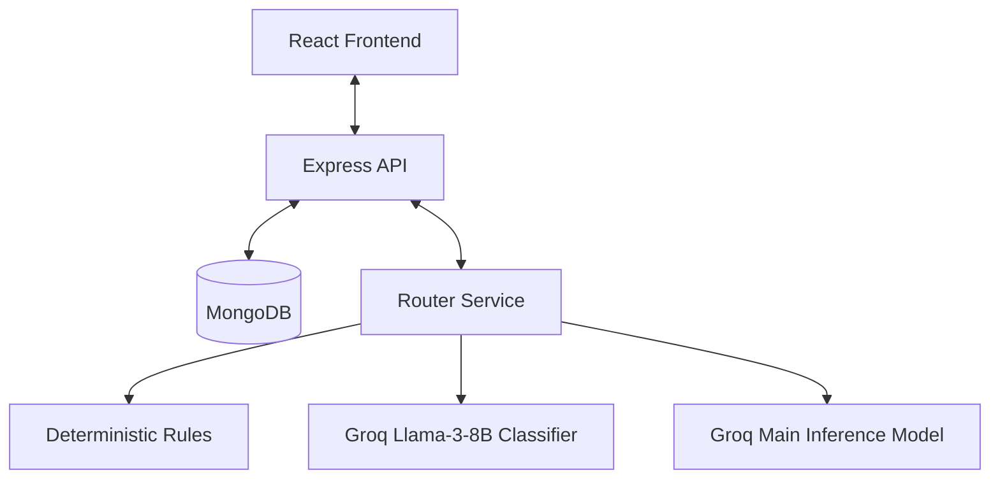

# Requirements

### Overview & Goals
The goal is to build "Heroku for Groq" (HFG), a simple MERN-based chat application that mimics the user experience of leading AI interfaces (ChatGPT/Claude) while abstracting model selection from the user. The backend will intelligently route queries to the most appropriate model on Groq using a mix of deterministic rules and a small-model classifier.

### Scope
- **In Scope**:
    - User authentication and account management.
    - Persistent chat sessions saved to MongoDB.
    - Intelligent routing service via Groq.
    - Semantic, minimal CSS-based UI.
- **Out of Scope**:
    - Image/File analysis (initially).
    - Multi-modal capabilities.
    - Team/Collaboration features.

### User Stories
- **As a user**, I want to create an account so that my chat history is saved across devices.
- **As a user**, I want to chat with an AI without worrying about which model is best for my specific question.
- **As a user**, I want to see my past sessions and continue them later.

### Functional Requirements
- Secure login and registration.
- Real-time chat interface with streaming support (optional but recommended).
- Automatic model routing based on query complexity.
- Sidebar for session navigation.
- Responsive design using semantic HTML and minimal CSS.

# Technical Design

### Architecture Context
The application follows a standard MERN (MongoDB, Express, React, Node) architecture, with a heavy emphasis on a specialized "Router Service" in the backend.

### Key Decisions
- **Authentication**: Custom JWT implementation with HTTP-only cookies for security and simplicity in a standalone project.
- **Model Routing**: 
    - **Tier 1 (Deterministic)**: Fast checks for keywords, code blocks, or short queries.
    - **Tier 2 (Classifier)**: Use `llama3-8b-8192` on Groq to categorize the prompt complexity.
    - **Tier 3 (Inference)**: Route to `llama3-70b-8192` for high complexity or stay with the smaller model for simple tasks.
- **Styling**: No utility frameworks (Tailwind). Use Semantic CSS with CSS Variables for consistency and reusable classes (e.g., `.card`, `.chat-message`) to keep the codebase clean and maintainable.

### Architecture Diagram

### Data Models
- **User**: `id`, `username`, `passwordHash`.
- **Session**: `id`, `userId`, `title`, `updatedAt`.
- **Message**: `id`, `sessionId`, `role` (user/assistant), `content`, `modelName`, `timestamp`.

### File Structure (Proposed)
- `src/server/`: Express backend.
- `src/server/models/`: Mongoose schemas.
- `src/server/services/`: Logic for Groq routing.
- `src/client/`: Vite-based React frontend.
- `src/client/styles/`: CSS files (variables.css, base.css, components.css).

# Testing

### Validation Approach
Verification will focus on the accuracy of the routing logic and the security of the authentication flow.

### Key Scenarios
- **Simple Routing**: Verify that a greeting like "Hello" is handled by a smaller model.
- **Complex Routing**: Verify that a request for "Write a complex Python script for data analysis" is routed to a larger model.
- **Persistence**: Ensure messages sent in a session are still there after a page refresh.
- **Auth Security**: Ensure protected routes cannot be accessed without a valid JWT cookie.

# Delivery Steps

### ✓ Step 1: Backend Foundation & Authentication
Set up the Express server and MongoDB connection. Implement the User model and JWT-based authentication flow (register/login) with HTTP-only cookies.

- Initialize Node.js environment and install dependencies (`express`, `mongoose`, `jsonwebtoken`, `bcryptjs`, `cookie-parser`).
- Create `src/models/User.ts` and `src/models/Session.ts`.
- Implement authentication middleware and routes in `src/routes/auth.ts`.
- Set up the basic Express server in `src/index.ts`.

### ✓ Step 2: Intelligent Model Router Service
Develop the routing logic that selects the best model for a given prompt using Groq.

- Create `src/services/routerService.ts` to handle deterministic checks (regex, query length).
- Implement a classifier call using Llama-3-8B on Groq to categorize query complexity.
- Create a unified `chat` endpoint that integrates the router and returns the final AI response along with metadata about the chosen model.

### ✓ Step 3: Frontend Architecture & Semantic CSS
Set up the React frontend using Vite and implement the semantic CSS architecture.

- Initialize React with Vite and TypeScript in `src/client`.
- Create `src/client/styles/variables.css` for theme colors, spacing, and typography.
- Implement `src/client/styles/base.css` for semantic tag resets and `src/client/styles/components.css` for reusable classes like `.card`, `.btn`, and `.chat-bubble`.
- Build the basic layout using semantic HTML (`<main>`, `<nav>`, `<section>`).

### * Step 4: Chat UI & Session Management
Build the chat interface and integrate with the backend for session persistence.

- Implement `ChatWindow` and `Sidebar` components.
- Connect the frontend to the backend `/chat` and `/sessions` endpoints.
- Ensure that previous chat sessions are loaded and displayed in the sidebar.
- Implement session creation and automatic saving of chat history.